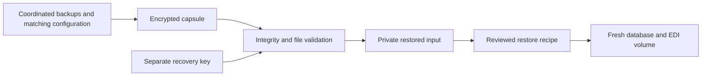

# Recovery capsule and controller replacement

## Using the envelope

Requirements are Linux with `renameat2`, Python 3.8 or later, GnuPG and `gpgconf`. First stage a closed, coordinated set of checked database dumps, the matching EDI volume archive, required secrets/PKI/configuration, role/grant recipes and pinned image/source manifests. Keep that directory unchanged while packing. Preserve filesystem metadata and empty directories inside the tested volume archive; the envelope validates a regular-file inventory and reconstructs its parent directories.

```sh
install -d -m 0700 ./recovery-keys ./recovery-artifacts
python3 scripts/recovery_capsule.py keygen --output ./recovery-keys/freight.key
python3 scripts/recovery_capsule.py create --source ./verified-recovery-input --key-file ./recovery-keys/freight.key --output ./recovery-artifacts/freight.gpg
python3 scripts/recovery_capsule.py restore --capsule ./recovery-artifacts/freight.gpg --key-file ./recovery-keys/freight.key --output ./recovery-artifacts/restored
```

These example paths are local. Production custody requires separately managed key access and an independent fault domain with a witnessed restore. The key must remain outside the input directory and is never included in the capsule. `keygen` creates 48 random bytes encoded as a URL-safe line, without logging it. An existing key must be a private regular file owned by the operator, containing one line of 32–4096 bytes. Existing output files and directories are refused.

The wrapper uses GnuPG AES256 with CFB+MDC, ignores user GnuPG options, uses a private temporary agent home and disables symmetric-key caching. Key transfer uses a file descriptor with nonblocking I/O under the same operation deadline; neither argv nor the child environment contains the key. Successful integrity status is required before archive validation. See the documented [GnuPG key-input/cache options](https://gnupg.org/documentation/manuals/gnupg/GPG-Esoteric-Options.html) and [OpenPGP encryption modes](https://gnupg.org/documentation/manuals/gnupg/OpenPGP-Options.html). The local GnuPG version is 2.2.19; this record does not qualify deployment packages or key custody.

| Limit                                      |    Default |
| ------------------------------------------ | ---------: |
| Combined regular-file bytes, `--max-bytes` | 8589934592 |
| Regular-file inventory, `--max-files`      |     100000 |

The decryptor also bounds raw archive output and GnuPG diagnostics. File names, SHA-256 hashes and sizes must match the encrypted manifest. Repeated JSON object members, duplicate/undeclared/missing files, traversal, symlinks, hardlinks, special archive members, conflicting paths and unexpected trailing data are refused. Private temporary staging is cleaned on failure; validated output is published atomically without replacing existing data. Files and publication directories are synced before successful return.



## Private extraction and the restore recipe

The extracted root and directories have mode `0700`. Files have mode `0600`, with owner execution retained where present. Apply a reviewed recipe after checking the recovered bytes. Public CA certificates and PostgreSQL’s public HBA configuration need their original readable permissions when bind-mounted into nonroot service containers. The corrected laboratory recipe verifies the original hashes before publishing `0644`; password environments stay `0600`. Original EDI metadata comes from its volume archive and checked manifest, while the host-file canary’s metadata is explicitly restored from its encrypted checkpoint.

Preserve original service configuration declarations. The unchanged image adapter already maps two host-only migration/data paths to fixed paths inside the images. Controller bookkeeping/source paths can move while the declarations and actual environment hashes remain unchanged. The laboratory handoff uses JSON and typed primitive values, with no pickle. Its recipe and input manifests are retained in the evidence; production source provenance and credentials still need independent commissioning.

## What passed and what failed

The tool’s cases exercise binary round trips, private modes, wrong keys after successful decryption, tampering, truncation, unencrypted input, unsafe archive members, inconsistent manifests, size/count bounds and atomic no-overwrite publication. A separate control reproduces the initial maximum-key deadlock: 4,096 key bytes plus newline cannot be prewritten into a 4,096-byte pipe before GnuPG starts. The current wrapper drains output/status while sending the key; both maximum-key round trips and malformed input pass with actual 4 KiB pipes.

```sh
python3 -m unittest discover -s scripts -p test_recovery_capsule.py -v
```

The three predecessor controller-loss attempts remain failures:

| Attempt                                 | Observed result                                                                                                                                                                  |
| --------------------------------------- | -------------------------------------------------------------------------------------------------------------------------------------------------------------------------------- |
| First fresh controller                  | Private extraction leaves public HBA unreadable; PostgreSQL refuses startup.                                                                                                     |
| Second fresh controller                 | Corrected HBA restores all tables/EDI metadata, then the original config hash guard refuses host-only path remapping.                                                            |
| Third independent checkpoint/controller | Original declarations, credentials, sealed web state and verified TLS recover; 64 named checks pass, then inbound attempt count is 3 instead of 2 after a database lock timeout. |

The third captured trace does not identify its blocking transaction. Full postfailure inbox body/authentication/delivery/history fields and a separate postfailure database dump were not retained before cleanup, so the combined guard’s other fields are not independently claimed as passing. The original coordinated encrypted backups, observed count, source-acceptance control flow, warning/SQL log and checked public diagnostic archives remain retained. Private keys, handoff data and passwords are excluded from public evidence; encrypted checkpoints and their separate keys remain in the private laboratory. The first two extra plaintext failure copies were removed only after checking their private files against the unchanged encrypted parents. No failed attempt is relabeled as a pass.

## Deadline contention fix

Code inspection found that cold tender-deadline preparation can take the tenant row lock outside the existing local write turn. Controlled PostgreSQL tests reproduce new writes returning 503 behind that actual row lock, while original receipts and readiness remain 200. Cancellation also leaves actual SQL ownership outside local admission. This proves the local mechanism; it does not identify the old restore trace’s holder.

The qualified successor routes deadline preparation through the existing bounded tenant write admission before pool acquisition. It retains ownership through actual commit/rollback, without taking a snapshot/CPU/page lease. Catalog/history keep their existing page leases. SQL, timeouts, connection limits, schema, formats and dependencies are unchanged. Both new guards and both existing catalog/history guards pass, including exact original replays and no physical source rewrite; strict all-target Clippy and formatting pass.