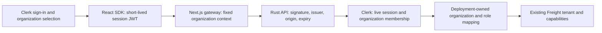

# Staff SSO with the existing StateSet Clerk instance

Shared-workspace browser recovery also needs a server-only `FREIGHT_SAVE_JOURNAL_KEYS_JSON` keyring or a valid `FREIGHT_SESSION_SECRET`. Configure it on every web replica and retain old encryption keys for unresolved originals. See [encrypted recovery and key rotation](sealed-save-journal.md). These keys are separate from Clerk’s public publishable key and must never be browser variables.

Freight supports staff sign-in through Clerk, matching the identity provider used in `stateset-app` (`lib/clerk-context.js`, `lib/server-security.js`, and its Clerk 5.61.9 React dependency were inspected). Freight uses standard v2 Clerk session tokens, not StateSet App's Hasura JWT template or browser organization metadata. The Rust API makes the tenant/role decision for every request.



Counterparty-scoped carrier/customer organizations use the same signed-session/live-membership checks, with explicit server-owned `counterparty_id` and partner-only roles. See [partner configuration and `/portal`](partner-portal.md). Staff organizations remain unscoped and cannot mix with partner grants.

## Configure a real staff workspace

1. Use the Clerk instance already used by StateSet App. Enable/confirm your organization's SSO, staff enrollment, MFA policy, and allowed Freight application domain/redirects in that instance. No Clerk account, organization, invitation, or domain was created by this implementation.
2. Set `FREIGHT_DEMO=false` on both real services and configure PostgreSQL. On the Rust API, set `FREIGHT_CLERK_JSON` using the **actual immutable Clerk organization IDs**, existing canonical Freight tenant IDs, and explicit Clerk-role-to-Freight-role mappings:

```dotenv
FREIGHT_CLERK_JSON='{"issuer":"https://clerk.stateset.com","secret_key":"replace-with-your-real-Clerk-backend-secret","authorized_parties":["https://freight.your-domain.example"],"organizations":{"org_your_actual_id":{"tenant_id":"your_existing_freight_tenant","roles":{"org:freight_viewer":"viewer","org:freight_operations":"operations","org:freight_finance":"finance","org:freight_admin":"admin"}}}}'
```

The issuer is the configured Clerk Frontend API origin; use your actual instance rather than copying an example blindly. The backend secret is server-only. Do not put it in browser variables, source files, URLs, or public organization metadata. An organization cannot choose its own Freight tenant through its name, slug, endpoint metadata, or request headers. Unlisted organizations and unmapped roles receive 403. Clerk's built-in `org:admin` has **no implicit Freight administrator grant**; map roles deliberately. Membership may change dynamically in Clerk without issuing staff API credentials or restarting Freight.

3. On the Next.js web service, set:

```dotenv
FREIGHT_WEB_AUTH_MODE=clerk
FREIGHT_CLERK_PUBLISHABLE_KEY=pk_live_replace_with_your_public_key
FREIGHT_WEB_ORIGIN=https://freight.your-domain.example
FREIGHT_API_URL=http://your-private-freight-api:8090
```

The public key must belong to the same Clerk instance. These values are read at runtime; the public key is the only Clerk configuration returned in page props. `FREIGHT_WEB_ORIGIN` is fixed for mutation-origin validation. HTTPS is required outside loopback development. In this mode, the credential login endpoint and old encrypted workspace cookies cannot grant browser access. Staff must select an active approved organization; personal accounts cannot open a tenant. The organization switcher and account controls stay available when a selected organization has no Freight grant. Provider load failure shows an explicit retry screen with no credential fallback. SDK telemetry is disabled.

4. Keep `FREIGHT_API_KEYS_JSON` for explicitly authorized machine/EDI/sync access, or set it to `{}` for an SSO-only API. Static credentials retain their existing tenant/subject/role behavior. The API can run with Clerk and no static keys. Signed EDI callbacks and integration workers retain their existing independent credentials and are not made dependent on a browser staff session.
5. Configure the same instance/org/tenant/role mappings consistently across API replicas. Restart replicas after changing deployment mappings. `compose.yaml` forwards the secret JSON only to the API and the publishable key/mode only to the web service.

## Request verification and revocation

- Only RS256 signed v2 session tokens from the configured issuer/JWKS are accepted. Authorized-party (`azp`) origins must match exactly. `sub`, `sid`, `iat`, `nbf`, `exp`, version, and selected organization are required/checked; token lifetime is at most 120 seconds. Expired, future, pending, impersonated, wrong-origin, wrong-issuer, wrong-algorithm, or unscoped tokens cannot grant access. Header key URLs and browser role/tenant claims are not authorization inputs.
- The API checks the live Clerk session's user/status/expiry and the user's current organization membership on **every request**, including reads and idempotency replay. It verifies the returned user/organization and maps the live membership role through server configuration. Those grants are not cached. Revocation, removal, or role downgrade affects subsequent requests using the same still-signed token. A provider error/rate limit/malformed response fails closed with a generic 503 rather than accepting a stale grant. Already authenticated in-flight requests are not retroactively canceled by a later membership change.
- JWKS public keys are cached for up to five minutes. An unknown key ID refreshes the cache with a one-second retry throttle; rotation is tested against a real signed-token fixture. HTTP redirects are disabled and response sizes/timeouts are bounded. Backend secrets go only to Clerk's fixed `https://api.clerk.com/v1` endpoints. Local issuer/BAPI overrides are restricted to explicit API demo mode and HTTP loopback fixtures.
- An optional `audience` in `FREIGHT_CLERK_JSON` requires that exact audience on the default session token. With no configured audience, tokens carrying a separate audience are rejected. Configure default session claims accordingly; the frontend does not request a Hasura/custom JWT template.
- Clerk's React SDK obtains fresh session tokens. Requests retain the organization that rendered their form; the gateway forwards an explicit organization guard and the API compares it against verified identity. Organization changes remount the workspace. A stale operation cannot silently post into the newly selected tenant. Downloads use the short-lived `__session` cookie plus the same organization guard in the URL; **no token is put in URLs**. Known IDs from another tenant still return 404.
- The audit subject is `clerk:<immutable user ID>`, never a submitted username or browser role. Existing business rules, document integrity, expected versions, transaction locks, and finance approvals still apply. Logout uses Clerk's session sign-out/revocation flow; the old static-credential browser cookie cannot act as fallback in SSO mode.

Clerk's short-lived `__session` cookie follows its SDK/session design; it is not Freight's encrypted eight-hour `HttpOnly` credential cookie. Credential mode remains available for the existing local/demo workflow and explicit credentials. See Clerk's primary [session token](https://clerk.com/docs/guides/sessions/session-tokens), [manual verification](https://clerk.com/docs/guides/sessions/manual-jwt-verification), [session lookup](https://clerk.com/docs/reference/backend/sessions/get-session), and [cookie/session design](https://clerk.com/docs/guides/how-clerk-works/overview) documentation.

## Qualification and commissioning

Local tests generate/sign real RSA JWTs against an owned issuer/JWKS/session/membership fixture. They verify live role changes before replay, user/session binding, tenant isolation, pending/impersonated/expired/future/wrong-origin/forged tokens, required audience, signing-key rotation, provider outages, configuration validation, and stable audit identity. Browser tests run a second standalone web service in Clerk mode and exercise authenticated reads/writes, exact document bytes, downloads, removed membership, revocation, stale-organization submission, and rejection of old credential cookies. The SDK failure screen is exercised with external identity traffic blocked. Test private keys are intentionally public fixture material and are not production credentials.

The actual external Clerk sign-in, enterprise SSO/MFA redirect, real organization's role assignments, production domain registration, logout, and membership revocation must be commissioned with your own instance and authorized staff. No live provider credential or staff account was used locally. Verify two real organizations with an overlapping user, role downgrade, membership removal, session logout/replay, and cross-tenant document IDs before enabling production staff access. A working synthetic fixture is not evidence of a configured live instance.

This provides tenant-wide **staff** access. Customer/carrier portal filtering, independent invoice-entry/approval duties, and your provider's invitation/SCIM policies require their own configuration/workflows. Freight does not automatically create or invite users or edit organization grants in Clerk.